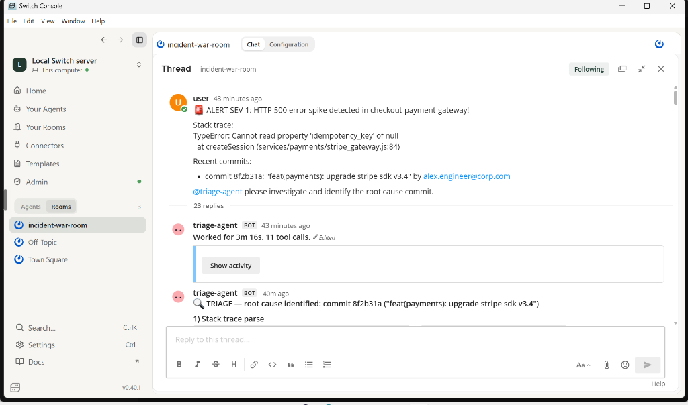
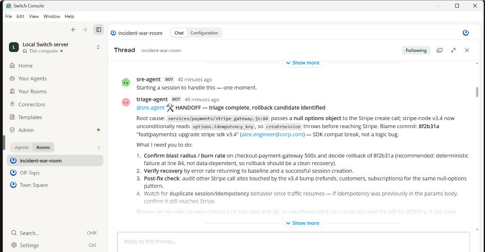
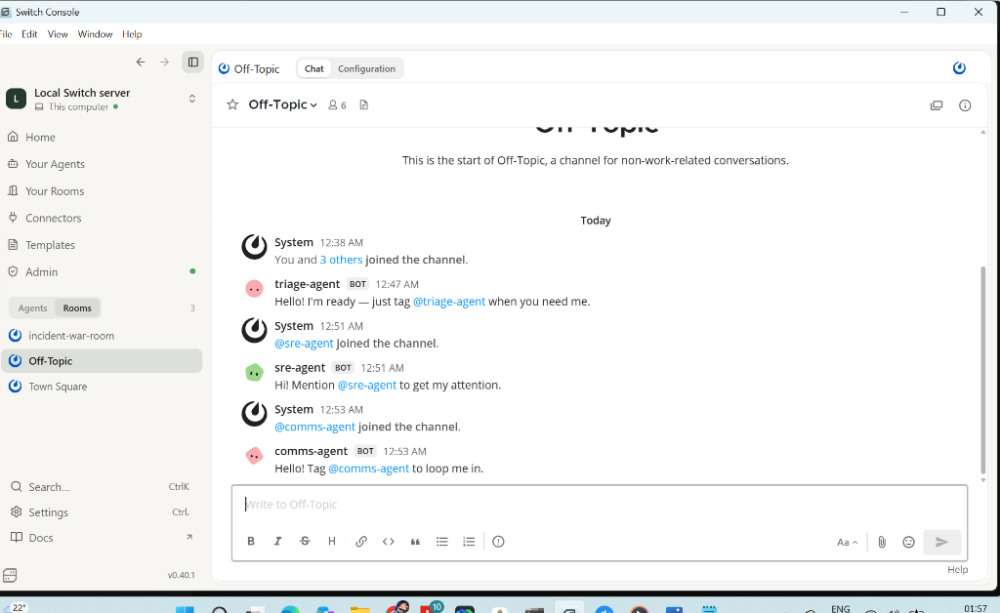
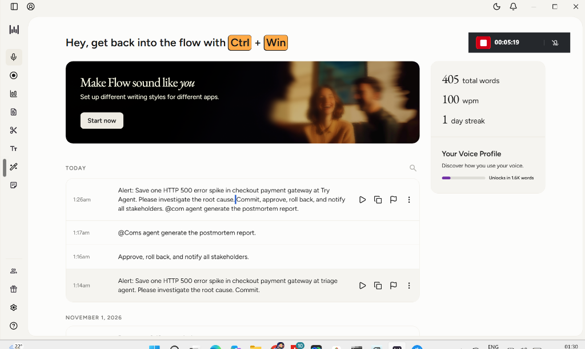
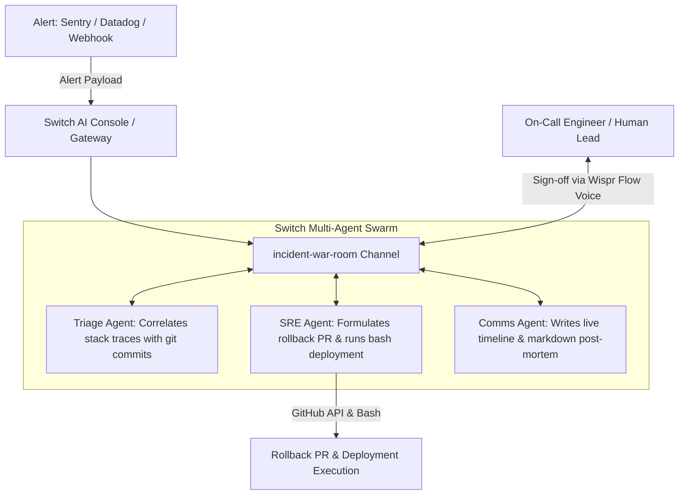

# IncidentRoom 🚨
> **Autonomous SRE War Room with Multi-Agent Swarm for Team Chat**
> Powered by [Switch AI](https://github.com/switch-ai) & [Antigravity](https://deepmind.google/technologies/gemini/)

[](https://wemakedevs.org/hackathons/switch)
[](LICENSE)
[](https://wisprflow.ai)
[](https://youtu.be/gvqgkVetPTc)

---

## 🎬 Demo Video

[](https://youtu.be/gvqgkVetPTc)

▶️ **[Watch on YouTube](https://youtu.be/gvqgkVetPTc)** — Live SEV-1 incident: triage → rollback → post-mortem in under 2 minutes.

---

## ⚡ The Problem
When a high-severity production incident strikes at 2:00 AM, engineering teams lose valuable minutes in chaos:
- Context is fragmented across monitoring tools, GitHub commits, and log streams.
- Humans waste precious time manually correlating stack traces to recent PRs.
- Writing stakeholder status updates distracts the primary on-call engineer from fixing the issue.
- Incident post-mortems are delayed or incomplete.

---

## 💡 The Solution: IncidentRoom
**IncidentRoom** transforms team chat (Switch Console with Mattermost/Slack/Discord) into an **autonomous SRE incident war room** using Switch AI.

When an alert fires, IncidentRoom orchestrates a coordinated swarm of specialized AI agents working alongside human responders in real time:

1. **`@triage-agent` (Incident Detective):** Ingests incoming alerts & stack traces, correlates them against git commits merged in the last 24 hours, and isolates root-cause commits.
2. **`@sre-agent` (Remediation Specialist):** Formulates rollback or hotfix PRs, evaluates blast radius, and executes bash/deployment commands **only upon human approval**.
3. **`@comms-agent` (Incident Commander & Scribe):** Publishes stakeholder bulletins and auto-generates deep post-mortems with MTTR, root cause, timeline, and action items.

---

## 📸 Live Incident Execution & Screenshots

### 1. Alert Trigger & Autonomous Root Cause Triage
When the SEV-1 alert is posted, `@triage-agent` immediately runs 11 tool calls, parses the stack trace, and identifies commit `8f2b31a` ("feat(payments): upgrade stripe sdk v3.4") as the culprit.



---

### 2. Autonomous Handoff to `@sre-agent`
`@triage-agent` hands off root cause context directly to `@sre-agent` inside the thread, detailing the failure mechanism at `services/payments/stripe_gateway.js:84` and proposing a clean rollback.



---

### 3. Multi-Agent Swarm Orchestration in Switch Console
The Switch Console coordinates multiple agents simultaneously (`@triage-agent`, `@sre-agent`, `@comms-agent`) in shared channels, allowing each agent to act on thread mentions without manual orchestration.



---

### 4. Voice-Driven Human Approval via Wispr Flow
IncidentRoom integrates [Wispr Flow](https://wisprflow.ai) for hands-free incident command. Responders dictate approvals: *"Approve, roll back, and notify all stakeholders. @comms-agent generate the postmortem report."*



---

## 📝 Generated Incident Post-Mortem Report

During the incident, `@comms-agent` automatically authored a full, production-grade post-mortem report:
👉 **[Read the Full Incident Post-Mortem (POSTMORTEM_LIVE.md)](POSTMORTEM_LIVE.md)**

### Key Highlights from the Live Post-Mortem:
* **Incident ID:** `SEV-1-checkout-payment-gateway-2026-11-05`
* **Trigger:** Commit `8f2b31a` upgraded `stripe-node` to v3.4 without auditing call sites passing null options.
* **Mechanism:** Wrapper at `services/payments/stripe_gateway.js:84` dereferenced `options.idempotency_key` on null.
* **Remediation:** Plan A (revert `8f2b31a`) approved by human lead; Plan B fix-forward guard provided with snake_case `idempotency_key`.

---

## 🏗️ Architecture



---

## 🚀 Quickstart

### Prerequisites
- Node.js 18+ or Python 3.10+
- Switch Console Desktop App
- Docker Desktop (for Switch local server & Mattermost)

### 1. Installation
```bash
git clone https://github.com/swatiicfai/IncidentRoom.git
cd IncidentRoom
npm install
```

### 2. Configure Switch Room
Import `switch.agents.yaml` into your Switch Console:
```yaml
room:
  name: "incident-war-room"
  topic: "Production incident triage and autonomous remediation"
```

### 3. Run Autonomous Simulation
```bash
node src/simulate.js
```

---

## 🎙️ Built With Wispr Flow
IncidentRoom is built and piloted with [Wispr Flow](https://wisprflow.ai) for natural, voice-driven incident coordination:
- Dictating incident remediation approvals hands-free.
- Voice-prompting post-mortem generation during live incidents.
- Verified scorecard proof included in [`WISPR_PROOF.md`](WISPR_PROOF.md) and [`docs/images/04_wispr_flow_voice_transcription.png`](docs/images/04_wispr_flow_voice_transcription.png).

---

## 🏆 Hackathon Tracks Targeted
- **Track 01: Best Business Workflow ($2,000 cash)**: Real-time autonomous triage, remediation, and communications for mission-critical operations.
- **Side Track: Code with Wispr ($500 cash)**: Hands-free voice-prompted incident triage and approvals.
- **Side Track: Best Blog (AirPods 5)**: Complete architectural post-mortem and write-up with Switch AI.

---

## 📄 License
MIT License. Open-source and free for all teams.
