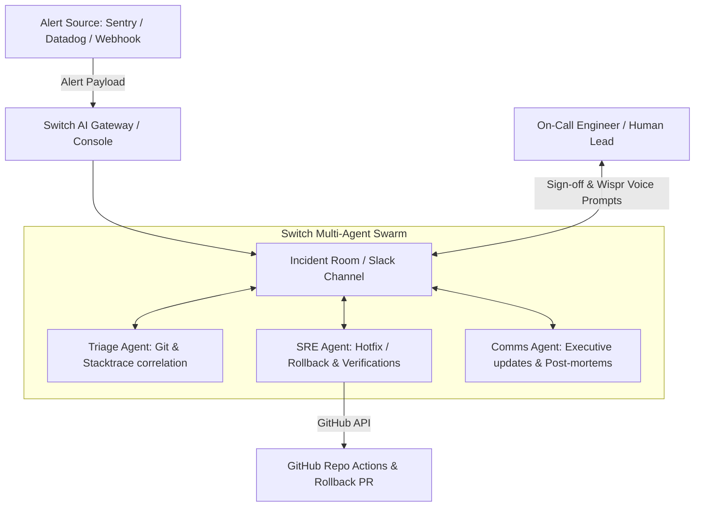

# IncidentRoom 🚨
> **Autonomous SRE War Room with Multi-Agent Swarm for Team Chat**
> Powered by [Switch AI](https://github.com/switch-ai) & [Antigravity](https://deepmind.google/technologies/gemini/)

[](https://wemadevs.org/hackathons/switch)
[](LICENSE)
[](https://wisprflow.ai)

---

## ⚡ The Problem
When a high-severity production incident strikes at 2:00 AM, engineering teams lose valuable minutes in chaos:
- Context is fragmented across monitoring tools, GitHub commits, and log streams.
- Humans waste precious time manually correlating stack traces to recent PRs.
- Writing stakeholder status updates distracts the primary on-call engineer from fixing the issue.
- Incident post-mortems are delayed or incomplete.

## 💡 The Solution: IncidentRoom
**IncidentRoom** transforms any Slack, Discord, Microsoft Teams, or Telegram channel into an **autonomous SRE incident war room** using Switch AI.

When an alert fires, IncidentRoom orchestrates a coordinated swarm of specialized AI agents working alongside human responders in real time:

1. **`@triage-agent` (Incident Detective)**: Ingests the exception/alert, analyzes stack traces, correlates with git commits merged in the last 24 hours, and isolates root-cause commits.
2. **`@sre-agent` (Remediation Specialist)**: Proposes remediations, creates rollback/hotfix PRs, and executes safety checks upon **human approval**.
3. **`@comms-agent` (Incident Commander & Scribe)**: Generates real-time executive bulletins, crafts customer-facing status updates, and auto-generates a post-mortem report when resolved.

```
+-----------------------------------------------------------------------------------+
|                                  TEAM CHAT ROOM                                   |
|                          (#incident-prod-api-500-checkout)                         |
|                                                                                   |
|  [Alert]  🚨 PagerDuty: HTTP 500 error spike in checkout-service                  |
|                                                                                   |
|  [Triage] 🔍 @triage-agent: Correlating logs with recent commits...               |
|           Root cause identified: Commit #9e4b1a ('Update stripe v3 sdk client')   |
|           Author: @developer | Culprit: Null reference in payment intent payload  |
|                                                                                   |
|  [SRE]    🛠️ @sre-agent: Rollback branch created [rollback-stripe-v3-9e4b].      |
|           Tests pass on staging. @oncall-lead, reply 'APPROVE' to deploy.         |
|                                                                                   |
|  [Human]  🧑‍💻 @oncall-lead: "APPROVE"                                               |
|                                                                                   |
|  [SRE]    🚀 @sre-agent: Deployed rollback. Health checks passing (200 OK).       |
|                                                                                   |
|  [Comms]  📝 @comms-agent: Incident resolved! MTTR: 4m 12s.                      |
|           Published post-mortem & incident summary to wiki.                        |
+-----------------------------------------------------------------------------------+
```

---

## 🏗️ Architecture



---

## 🚀 Quickstart

### Prerequisites
- Python 3.10+ or Node.js 18+
- Switch Console / Desktop Client
- GitHub Personal Access Token (for PR creation and commit inspections)

### 1. Installation
```bash
git clone https://github.com/swatiicfai/IncidentRoom.git
cd IncidentRoom
pip install -r requirements.txt
```

### 2. Configure Environment
Create a `.env` file from `.env.example`:
```env
GITHUB_TOKEN=your_github_token
SLACK_WEBHOOK_URL=your_webhook_url # (or Discord / Switch webhook)
INCIDENT_ROOM_PORT=8000
```

### 3. Launch Switch Room
Run the IncidentRoom orchestration server:
```bash
python -m incident_room.server
```

### 4. Trigger a Test Incident
Simulate a production outage to watch the agents swarm in real time:
```bash
python scripts/simulate_incident.py --type checkout_failure
```

---

## 🎙️ Built With Wispr Flow
IncidentRoom is built and piloted with [Wispr Flow](https://wisprflow.ai) for natural, voice-driven incident coordination:
- Dictating incident remediation approvals hands-free.
- Generating incident updates and post-mortems with voice-to-text accuracy.

---

## 🏆 Hackathon Tracks Targeted
- **Best Business Workflow (\$2,000)**: Real-time autonomous triage, remediation, and communications for mission-critical operations.
- **Code with Wispr (\$500)**: Hands-free incident response and voice-dictated commands.
- **Best Blog (AirPods 5)**: Complete architectural write-up on autonomous incident war rooms with Switch AI.

---

## 📄 License
MIT License. Open-source and free for all teams.
