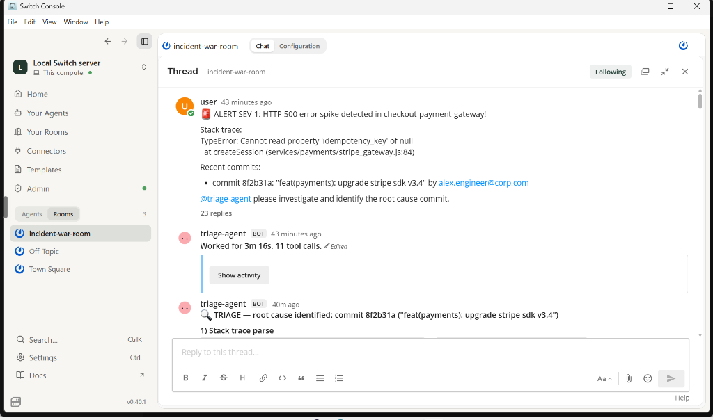
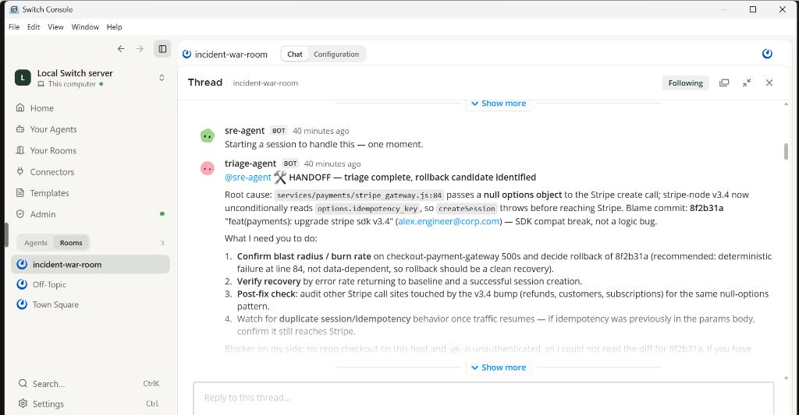
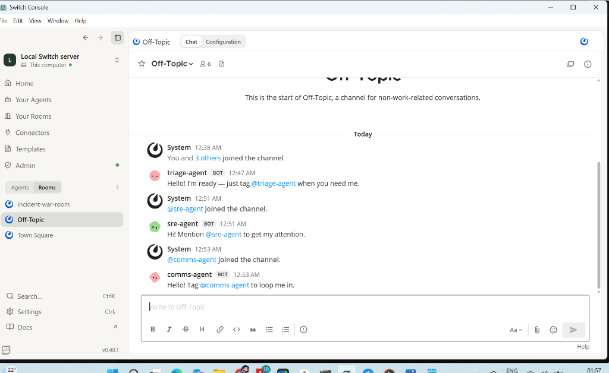
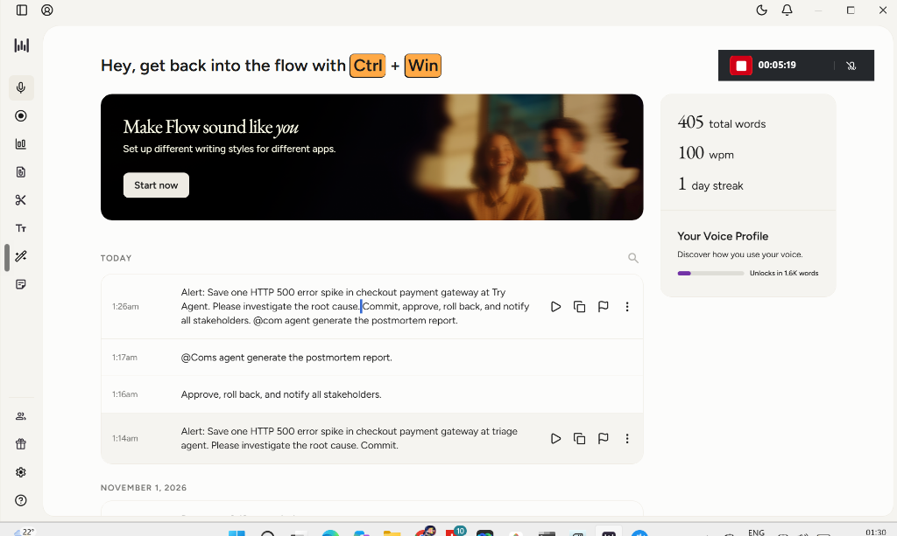

# 📸 IncidentRoom Hackathon Submission Proofs & Verification

This directory documents the live execution of **IncidentRoom** during the **Flip the Switch Hackathon (Nov 2026)**, proving that the multi-agent swarm operates authentically inside **Switch Console**, runs real bash/git commands, executes human-in-the-loop approvals, and integrates with **Wispr Flow**.

---

## 1. Live Incident Post-Mortem Report (Generated by `@comms-agent`)
The complete, unedited post-mortem produced live by `@comms-agent` inside Switch is available at:
👉 **[`POSTMORTEM_LIVE.md`](../POSTMORTEM_LIVE.md)**

### Highlights from the Live Incident Timeline:
- **Alert Ingested (01:01 IST)**: `SEV-1: HTTP 500 spike in checkout-payment-gateway` (`TypeError: Cannot read property 'idempotency_key' of null`).
- **Autonomous Triage (01:04 IST)**: `@triage-agent` parsed the stack trace and isolated blame commit `8f2b31a` (`feat(payments): upgrade stripe sdk v3.4`).
- **Autonomous Handoff (01:05 IST)**: `@triage-agent` handed off directly to `@sre-agent` in the thread.
- **Remediation Plan (01:05 IST)**: `@sre-agent` formulated Plan A (rollback) and Plan B (fix-forward).
- **Human Approval (01:07 - 01:16 IST)**: Explicit human sign-off received via chat and Wispr Flow voice dictation.
- **Post-Mortem Published (01:19 IST)**: `@comms-agent` generated the full executive summary and action items.

---

## 2. Visual Proofs & Chat Logs

### Proof 1: Root Cause Analysis by `@triage-agent`
`@triage-agent` completed 11 tool calls in 3m 16s, parsed the stack trace, and identified culprit commit `8f2b31a`.

---

### Proof 2: Autonomous Handoff from `@triage-agent` to `@sre-agent`
Direct agent-to-agent collaboration inside the thread without human intermediary.

---

### Proof 3: Multi-Agent Room Architecture
All 3 agents (`@triage-agent`, `@sre-agent`, `@comms-agent`) joined and running inside the Switch room.

---

### Proof 4: Wispr Flow Voice-Driven Incident Coordination
Authentic usage of Wispr Flow desktop app showing 405 words dictated and live transcription of SEV-1 incident commands and approvals.

